  <picture><source media="(prefers-color-scheme: dark)" srcset="assets/header-dark.svg" /></picture>

  <picture><source media="(prefers-color-scheme: dark)" srcset="https://readme-typing-svg.demolab.com?font=Lora&weight=500&size=20&pause=2200&color=E6DFCC&center=true&vCenter=true&width=600&lines=I+build+small+tools+for+developers.;Mostly+Rust%2C+Go%2C+Python+and+TypeScript.;Right+now%3A+wuts-that-bash." /></picture>

  
  
  
  

<table>
<tr>
<td width="50%" valign="top">

#### About

I build small tools, mostly ones I wanted for myself: a faster way to find that command I ran last month, a side panel that translates articles while I read, an alert bot that only wakes me up when something is actually broken.

</td>
<td width="50%" valign="top">

#### Stack
<picture><source media="(prefers-color-scheme: dark)" srcset="https://skillicons.dev/icons?i=py%2Cts%2Cgo%2Crust%2Cbash%2Creact%2Cnextjs%2Cdocker%2Caws%2Cpostgres&perline=5&theme=dark" /></picture>

</td>
</tr>
<tr>
<td valign="top">
<a href="https://github.com/duylongpro99/wuts-that-bash"><picture><source media="(prefers-color-scheme: dark)" srcset="https://github-readme-stats.vercel.app/api/pin/?username=duylongpro99&repo=wuts-that-bash&bg_color=252b26&title_color=c8693c&text_color=e6dfcc&icon_color=8fa876&hide_border=true" /></picture></a>
</td>
<td valign="top">
<a href="https://github.com/duylongpro99/translate-side"><picture><source media="(prefers-color-scheme: dark)" srcset="https://github-readme-stats.vercel.app/api/pin/?username=duylongpro99&repo=translate-side&bg_color=252b26&title_color=c8693c&text_color=e6dfcc&icon_color=8fa876&hide_border=true" /></picture></a>
</td>
</tr>
<tr>
<td valign="top">
<picture><source media="(prefers-color-scheme: dark)" srcset="https://github-readme-stats.vercel.app/api?username=duylongpro99&show_icons=true&bg_color=252b26&title_color=c8693c&text_color=e6dfcc&icon_color=8fa876&ring_color=c8693c&hide_border=true" /></picture>
</td>
<td valign="top">
<picture><source media="(prefers-color-scheme: dark)" srcset="https://streak-stats.demolab.com?user=duylongpro99&background=252b26&ring=c8693c&fire=c8693c&currStreakNum=e6dfcc&sideNums=e6dfcc&currStreakLabel=c8693c&sideLabels=9a9886&dates=9a9886&stroke=9a9886&hide_border=true" /></picture>
</td>
</tr>
</table>

### Activity

<picture><source media="(prefers-color-scheme: dark)" srcset="https://github-readme-activity-graph.vercel.app/graph?username=duylongpro99&bg_color=252b26&color=e6dfcc&title_color=e6dfcc&line=c8693c&point=8fa876&area=true&area_color=c8693c&hide_border=true" /></picture>

More about me

- I ship CLI tools you can `brew install`.
- I turn language curricula into videos with Python pipelines.
- I am always one side project away from a new side project.

